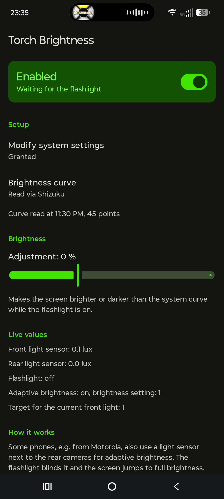

# Torch Brightness

> [!Warning]
> This app was vibe coded (written largely with AI assistance) and has not been tested extensively
> yet. Use it at your own risk.

Keeps the screen brightness sane while the flashlight is on.

Some phones (e.g. the Motorola Edge 60 Pro) also feed a light sensor next to the rear cameras into
adaptive brightness. The flashlight blinds that sensor, adaptive brightness thinks it is in bright
sunlight, and the screen jumps to full brightness. On the Edge 60 Pro this is the framework resource
`config_isCombineFrontRearLightSensor`, which cannot be changed without root.

While the flashlight is on (no matter how it was turned on), this app:

1. pauses adaptive brightness,
2. sets the brightness itself from the **front** light sensor only, using the system's own adaptive
   brightness curve including your personal adjustments (read from `dumpsys display`),
3. restores adaptive brightness and your previous brightness setting when the flashlight turns off.

If you move the brightness slider while the flashlight is on, the app stops adjusting until the
flashlight turns off. If adaptive brightness was off, the app does nothing.

The UI is available in English and German and follows the system language.

## Screenshots

| Main screen |
|---|
|  |

## Setup

1. Install the APK and enable the app.
2. Allow **Modify system settings** (button in the app).
3. Give the app access to the brightness curve, either
   - once via adb (no Shizuku needed afterwards):
     ```bash
     adb shell pm grant de.xitee.torchbrightness android.permission.DUMP
     ```
   - or via [Shizuku](https://shizuku.rikka.app/): start Shizuku and tap "Allow" in the app.

## Structure

| Package | Purpose |
|---|---|
| `curve/` | Reads `dumpsys display` (directly with DUMP or through a Shizuku user service) and evaluates the `PhysicalMappingStrategy` splines |
| `brightness/` | Front/rear light sensors, lux smoothing, system brightness settings |
| `service/` | Foreground service watching the flashlight and controlling the brightness |
| `ui/` | Compose UI; strings in `res/values` (English) and `res/values-de` (German) |

## Build

```bash
./gradlew :app:assembleDebug
```

Release signing: locally via `keystore.properties` (not in the repo); in GitHub Actions via the
secrets `SIGNING_KEYSTORE_BASE64`, `SIGNING_STORE_PASSWORD`, `SIGNING_KEY_ALIAS`, `SIGNING_KEY_PASSWORD`.
Every push to `main` builds a signed APK as a workflow artifact; a `v*` tag also creates a release.

## License

Torch Brightness is free software licensed under the
**GNU General Public License, version 3 or later**. See [LICENSE](LICENSE) for
the full text.

```
Copyright (C) 2026 Xitee

This program is free software: you can redistribute it and/or modify it under
the terms of the GNU General Public License as published by the Free Software
Foundation, either version 3 of the License, or (at your option) any later
version.

This program is distributed in the hope that it will be useful, but WITHOUT
ANY WARRANTY; without even the implied warranty of MERCHANTABILITY or FITNESS
FOR A PARTICULAR PURPOSE. See the GNU General Public License for more details.
```
